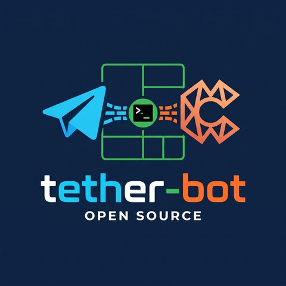

<p align="center">
  
</p>

<h1 align="center">tether-bot</h1>

<p align="center">
  <b>Leave your computer on. Keep working with Claude Code from your phone.</b><br/>
  A Telegram bot and a web dashboard for the Claude Code sessions running on your own machine.
</p>

---

Tether connects the [Claude Code](https://docs.claude.com/en/docs/claude-code) CLI on **your** computer to:

- **Telegram:**
  - talk to any session and switch between them;
  - receive Claude's answers;
  - answer its questions and approve permissions with buttons;
  - send photos and files;
  - resume old conversations.
- **A web dashboard:**
  - sessions and a full chat with attachments;
  - slash commands and model/effort switching;
  - context and plan-limit charts;
  - a live terminal view.

It uses your local `claude` login. Nothing is proxied to a third party, and there's no API key to configure. Each session is a normal `claude` process inside `tmux`, so you can still `tmux attach` to it at any time.

```
 Telegram ─┐                        ┌─ tmux ─ claude (project A)
           ├─ Tether (127.0.0.1) ───┼─ tmux ─ claude (project B)
 Browser ──┘                        └─ tmux ─ claude (…)
```

> Tether is a community project, not affiliated with Anthropic. "Claude" and "Claude Code" are trademarks of Anthropic.

## Quick start

**Requirements:**
- Linux or macOS
- [Node.js 22.13+](https://nodejs.org)
- `tmux` and `curl`
- Claude Code, installed and logged in (`claude`)

```bash
git clone https://github.com/pablobelmiro/thether-bot.git
cd thether-bot
./install.sh
```

The installer:
1. checks the requirements;
2. builds the project;
3. links the `tether` command into `~/.local/bin`;
4. adds Tether's hooks to `~/.claude/settings.json` (keeping a backup);
5. on Linux, offers to run Tether as a background service.

Then open **<http://127.0.0.1:4100>**. The first-run wizard asks for:

1. **a language**: English, Português or Español;
2. **a password**, 8+ characters. It's used for the dashboard and to unlock the bot;
3. **the phone numbers allowed to use the bot**, with country code, e.g. `5511999998888`;
4. **a Telegram bot token**. You can add it later; see below.

### Create your Telegram bot (2 minutes)

1. In Telegram, open [@BotFather](https://t.me/BotFather) and send `/newbot`.
2. Pick a name and a username. BotFather replies with a token like `123456789:AAH…`.
3. Paste it in the wizard, or later in **Settings → Telegram**.
4. Open your bot, send `/start` and tap **📱 Share my contact**. Tether checks that the number is on your allow list.
5. Unlock with `/password <your password>`. The bot deletes that message right away.

Then just type. Your message goes to the active session, and Claude's answer comes back to the chat.

## Using the bot

| Command | What it does |
|---|---|
| *any text* | Send it to the active session |
| *photo / file* | Attach it (the caption becomes the message) |
| `/change [name]` | Switch the active session. 📬 shows answers you haven't read yet. |
| `/resume` | Resume any recent Claude Code conversation from this machine |
| `/repos` | Open a new session in a recent project |
| `/status` | Model, effort, context and plan limits of the active session |
| `/usage` | Plan limits (5h / 7d) with bars, context per session, money spent |
| `/screen` | Snapshot of the terminal |
| `/model`, `/effort` | Change model or effort (buttons, or pass a value) |
| `/clear` | Clear the session's context (asks for confirmation) |
| `/cancel` | Interrupt Claude |
| `/lock` | Lock the bot now |
| `/lang` | Change your language |
| `/help` | Show everything |

Localized aliases also work, e.g. `/senha`, `/ajuda`, `/tela` in Portuguese and `/clave`, `/ayuda`, `/pantalla` in Spanish.

**Answers from other sessions** don't get lost. While you're in session A, answers from session B go to an inbox (📬), and you receive them when you `/change` to B.

## Using the dashboard

- **Overview:** sessions, account limits with reset times, context per session, usage over 24 h, recent activity, bot status.
- **Session:**
  - full conversation (read from Claude Code's own transcript, so messages from Telegram and the terminal show up too);
  - attachments by button or drag & drop;
  - type `/` for commands;
  - model and effort selectors;
  - live terminal;
  - restart, clear and remove.
- **Sidebar:**
  - **+** new session;
  - **🕘** resume a past conversation;
  - **⇄** adopt a tmux session you started yourself.
- **Settings:**
  - language and default permission mode;
  - idle lock;
  - Telegram token and bot restart;
  - verified users;
  - password and allow list;
  - audit log.

## Permission modes

Each session runs in one of two modes, chosen when you create or resume it:

| Mode | Behavior |
|---|---|
| **Ask** (default) | Claude's permission prompts appear in the dashboard and on Telegram with buttons. Answer from anywhere; the other places update. |
| **Bypass** | Claude runs with `--dangerously-skip-permissions` and never asks. Convenient, but only use it for folders and work you trust. |

The mode applies when the session starts. A conversation that began in one mode can be resumed in the other.

## Security

Tether can make Claude run commands on your computer, so access is locked down:

- **Bot access:** Telegram users need **their own phone number on your allow list** *and* **the password**. The bot locks again after a configurable idle time (default 12 h) and on every restart.
- **Can't run unprotected:** the bot refuses to start without a password and at least one allowed number, and the last number can't be removed.
- **Network:** the dashboard listens on **127.0.0.1 only** and needs the same password.
- **Storage:**
  - the password is stored with scrypt;
  - the bot token is encrypted with AES-256-GCM using a local key (mode 600);
  - only token hashes are stored for dashboard logins.
- **Process execution:** no shell strings are built from input; `tmux` and `claude` are called with argument lists.
- **Audit log:** every login, unlock, configuration change and permission answer is recorded.

Read [SECURITY.md](SECURITY.md) for the full model and recommendations. Don't expose port 4100 to the internet.

## Configuration

Everything user-facing lives in the dashboard (stored in `~/.tether/tether.db`). Process options:

| Variable | Default | Meaning |
|---|---|---|
| `TETHER_PORT` | `4100` | HTTP port |
| `TETHER_HOST` | `127.0.0.1` | Bind address. Keep it local. |
| `TETHER_HOME` | `~/.tether` | Database, keys, uploads |
| `TETHER_CLAUDE_BIN` | `claude` | Claude Code executable |
| `CLAUDE_CONFIG_DIR` | `~/.claude` | Claude Code settings and transcripts |
| `TETHER_DEBUG` | | `1` for verbose logs |

### CLI

```bash
tether                     # start the server (foreground)
tether setup [--claude-md] # (re)install hooks + status line; optionally add the phone formatting guide to ~/.claude/CLAUDE.md
tether doctor              # check Node, tmux, claude, hooks, password, phones, token
tether passwd              # set a new password from the terminal (if you forgot it)
tether import-env <file>   # seed settings from KEY=VALUE lines (see .env.example)
tether service install     # systemd user service (Linux)
tether service uninstall
tether uninstall-hooks     # remove Tether from ~/.claude/settings.json
```

## Troubleshooting

| Problem | Fix |
|---|---|
| The bot doesn't answer at all | It only answers allowed numbers. Send `/start` and share your contact. If it still ignores you, check the number in Settings → Security (digits with country code) and the server log. |
| "Conflict: terminated by other getUpdates request" | Two programs are using the same bot token. Stop the other one (only one Tether per token). |
| Sessions show "unknown model" / no context % | The status line forwarder isn't active for that session yet. Run `tether setup`, then restart the session. |
| A session I started myself isn't listed | Start it inside tmux, then use **Adopt** in the dashboard. Or use **Resume** to reopen its conversation. |
| Answers don't arrive after `/clear` | They should. If not, check that the hooks are installed (`tether doctor`). |
| Forgot the password | Run `tether passwd` on the machine. |
| Logs | `journalctl --user -u telegram-claude-tether -f` (service), or the terminal running `tether`. |

## Uninstall

```bash
tether service uninstall      # if you installed the service
tether uninstall-hooks
rm -rf ~/.tether ~/.local/bin/tether
```

Then delete the cloned folder.

## Contributing

Issues and pull requests are welcome. Translations especially: adding a language is copying one folder. See [CONTRIBUTING.md](CONTRIBUTING.md) and [docs/ARCHITECTURE.md](docs/ARCHITECTURE.md).

## License

[MIT](LICENSE). Some parts are adapted from Vibecraft (MIT); see [NOTICE](NOTICE).
